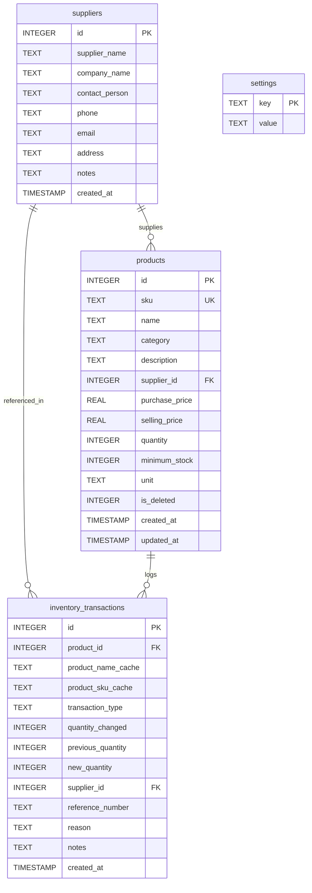

# Smart Inventory Management System (SIMS)
### Software Configuration Management (SCM) College Course Project

[](https://www.python.org/)
[](https://flask.palletsprojects.com/)
[](https://www.sqlite.org/)
[](https://getbootstrap.com/)
[](https://www.chartjs.org/)
[-449C44?logo=pytest&logoColor=white)](https://docs.pytest.org/)
[](https://www.jenkins.io/)

---

## 1. Project Overview

The **Smart Inventory Management System (SIMS)** is a modern, responsive web application developed as a college project for the **Software Configuration Management (SCM)** curriculum. It provides warehouse managers and inventory controllers with real-time visibility into product stocks, stock valuation, supplier relationships, inventory movements (Stock-In, Stock-Out, and Physical Adjustments), and automated low-stock warnings.

### Critical Architecture Directive: Zero Authentication (No Login / Signup)
In strict accordance with project evaluation requirements:
* **No login page, signup page, registration, password entry, OTP, or session redirection exists.**
* Launching the application opens **directly into the Inventory Dashboard**.
* All features, forms, reports, and operations are immediately usable without authentication gates.

---

## 2. Technology Stack

| Layer | Technology | Details |
| :--- | :--- | :--- |
| **Backend** | Python 3.11 / Flask 3.1 | Modular architecture, RESTful API endpoints, parameterized SQL queries |
| **Database** | SQLite3 | Foreign key enforcement (`PRAGMA foreign_keys = ON`), WAL mode, transactional ACID compliance |
| **Frontend** | HTML5, CSS3, JavaScript (ES6) | Responsive custom UI design system with Navy/Royal Blue palette & Dark Mode |
| **CSS Framework**| Bootstrap 5.3.3 + Bootstrap Icons | Grid layout, responsive drawer, modal dialogs, status badges |
| **Data Viz** | Chart.js 4.4.1 | Category distribution, top products, stock-in/out monthly timeline, inventory health |
| **Testing** | Pytest 9.1 | 25 automated unit and integration tests using temporary SQLite databases |
| **Continuous Integration** | Jenkins CI | Declarative `Jenkinsfile` pipeline with automated checkout, testing, and JUnit reporting |
| **Version Control** | Git & GitHub | Semantic commit history, branching models, tagged releases |

---

## 3. UI/UX Design System & Color Palette

The interface adopts a high-contrast corporate blue-and-white theme designed for operational clarity:

* **Primary Navy Blue**: `#173B67` (Sidebar, primary brand accents, dark headers)
* **Secondary Royal Blue**: `#3478F6` (Action buttons, interactive links, charts)
* **Application Background**: `#F4F7FB` (Light Gray canvas)
* **Card Surface**: `#FFFFFF` (Clean elevated containers with subtle shadows)
* **Success Green**: `#16A34A` (Stock In, In-Stock status, healthy inventory)
* **Warning Amber**: `#F59E0B` (Low Stock alert badges, audit adjustments)
* **Danger Red**: `#DC2626` (Out of Stock alert badges, Stock Out, deletions)
* **Dark Slate Text**: `#1E293B` (Primary typography with Google Fonts *Plus Jakarta Sans* & *Outfit*)
* **Dark Mode**: Toggleable from topbar, persisted across browser sessions via `localStorage`

---

## 4. Key Functional Modules

### 1. Real-Time Dashboard
* **Dynamic Summary Cards**: Real-time calculations of Total Products, Total Units in Stock, Low-Stock items, Out-of-Stock items, Active Suppliers, and Total Estimated Inventory Cost Value.
* **Interactive Chart.js Visualizations**:
  1. *Category Stock Distribution* (Doughnut chart with interactive tooltips)
  2. *Top Products by Quantity* (Horizontal bar chart)
  3. *Monthly Movement Timeline* (Grouped comparison of Stock In vs. Stock Out)
  4. *Inventory Health Ratio* (Status distribution breakdown)
* **Recent Activity Feed**: Real-time transaction ledger displaying recent warehouse entries and dispatches.
* **Quick Action Buttons**: Modal triggers for immediate product registration and stock movements.

### 2. Product Catalog Management
* **Fields**: SKU (auto-generated or custom), Product Name, Category, Description, Supplier, Purchase Price, Selling Price, Initial Stock, Minimum Threshold, Unit of Measurement.
* **Integrity Constraints**: Unique SKU validation, price & threshold non-negativity checks.
* **Search & Filters**: Live search by name/SKU, category dropdown filtering, status filtering (`In Stock`, `Low Stock`, `Out of Stock`), and multi-column sorting.
* **Audit-Safe Deletion**: Soft deletion (`is_deleted = 1`) ensures product deletions never erase historical transaction logs.

### 3. Stock Operations
* **Stock In (Receiving)**: Increases stock balance, records supplier PO reference, and commits an atomic transaction record.
* **Stock Out (Dispatch)**: Validates stock availability. **Strictly rejects negative stock attempts** (if requested quantity > available units).
* **Stock Adjustment (Audit Reconciliation)**: Allows inventory auditors to reconcile system quantities with physical warehouse cycle counts, calculating the exact quantity difference (+/-).

### 4. Supplier Directory
* Complete supplier profiles with company name, contact person, phone number, email (with regex validation), and physical address.
* Tracks the number of active products supplied by each vendor.
* **Safety Protection**: Prevents deletion of suppliers currently associated with active products.

### 5. Automated Low-Stock Alerts
* Real-time automated status classification:
  * `In Stock`: $\text{Quantity} > \text{Minimum Threshold}$
  * `Low Stock`: $0 < \text{Quantity} \le \text{Minimum Threshold}$
  * `Out of Stock`: $\text{Quantity} = 0$
* Suggested replenishment order calculation: $\text{Reorder} = \max(\text{Minimum Threshold} \times \text{Multiplier} - \text{Current Stock}, 1)$.
* One-click **"Restock"** action pre-populates the Stock-In modal.
* Header bell notification icon with dynamic red badge and live dropdown list.

### 6. Transaction Audit Ledger
* Comprehensive, tamper-evident log capturing: Transaction ID, Timestamp, Product SKU & Name cache, Movement Type (`Stock In`, `Stock Out`, `Opening Stock`, `Stock Adjustment`), Quantity Delta, Previous Balance, New Balance, Reference Number, and Reason.
* Live search, filtering by transaction type, start date, and end date.
* Filter-aware CSV export.

### 7. Reports & Analytics Engine
* **8 Standard Reports**:
  1. *Current Inventory Master Report*
  2. *Low-Stock Replenishment Report*
  3. *Out-of-Stock Critical Report*
  4. *Stock-In Receipts Summary*
  5. *Stock-Out Dispatches Summary*
  6. *Supplier Performance & Valuation*
  7. *Inventory Valuation Statement* (Calculates $\sum(\text{Quantity} \times \text{Purchase Price})$, potential retail realization, and gross margins)
  8. *Transaction Audit Ledger*
* Dedicated **Print View** (`window.print()`) with print-optimized CSS hiding navigation elements.
* Instant CSV downloads for products, low stock, and transactions.

### 8. System Settings & Demo Dataset Provisioning
* Configure store name, currency symbol (`$`, `₹`, `€`, `£`, `¥`), and reorder multiplier.
* **"Load Demo Data"**: Seeds realistic products across 6 categories, 4 suppliers, and sample movements for instant presentation.
* **"Clear All Data"**: Resets inventory and transaction logs while maintaining schema structure.

---

## 5. Database Schema (SQLite3)



---

## 6. Software Configuration Management (SCM) Demonstration

### A. Git Version Control Workflow

1. **Repository Setup**:
   ```bash
   git init
   git config user.name "Your Name"
   git config user.email "your.email@college.edu"
   ```

2. **Branching Strategy**:
   * `main`: Production-ready release branch.
   * `develop`: Integration branch for active features.
   * `feature/<feature-name>`: Specific module development (e.g., `feature/alerts-system`).

3. **Sample SCM Git Commands**:
   ```bash
   # Create and switch to develop branch
   git checkout -b develop

   # Stage and commit changes with conventional messages
   git add .
   git commit -m "feat(stock): implement stock adjustment and transaction audit logging"

   # Merge feature into develop with no fast-forward
   git checkout develop
   git merge --no-ff feature/alerts-system -m "merge: integrate low-stock alert subsystem"

   # Tag a milestone release on main
   git checkout main
   git merge develop
   git tag -a v1.0.0 -m "Release v1.0.0: Initial verified SCM project delivery"
   ```

### B. Automated Testing with Pytest

All business logic, database transactions, price constraints, and CSV exporters are covered by 25 automated tests in `tests/`:

* `tests/test_products.py`: Direct dashboard access (zero auth), product CRUD, duplicate SKU rejection, negative value rejection, soft deletion.
* `tests/test_suppliers.py`: Supplier registration, email regex validation, profile updates, and active product deletion guards.
* `tests/test_stock.py`: Stock In additions, Stock Out subtractions, insufficient stock rejection (negative stock prevention), audit count adjustments, and alert thresholds.
* `tests/test_reports.py`: Database-calculated dashboard metrics, inventory valuation formula, report data endpoints, and CSV download headers.

**Run the automated test suite locally**:
```bash
pytest
```

**Generate JUnit XML test report**:
```bash
pytest --junitxml=test-reports/junit-results.xml
```

### C. Jenkins CI Pipeline Integration

The included [`Jenkinsfile`](./Jenkinsfile) implements a cross-platform declarative Continuous Integration pipeline compatible with both Linux and Windows Jenkins nodes:

1. **Checkout SCM**: Clones the latest branch commit from GitHub.
2. **Prepare Environment**: Creates and activates an isolated Python virtual environment (`.venv`).
3. **Install Dependencies**: Installs packages listed in `requirements.txt`.
4. **Code Syntax Verification**: Compiles Python source files using `compileall` to catch syntax errors.
5. **Run Automated Pytest Suite**: Executes all 25 tests and writes `junit-results.xml`.
6. **Publish Test Results**: Archives test results into Jenkins graphs and dashboard badges.
7. **Post Actions**: Cleans workspace temporary files and marks build as `SUCCESS` or `FAILURE`.

---

## 7. Local Installation & Execution Guide

### Prerequisites
* Python 3.9, 3.10, or 3.11 installed on your system.
* Git installed.

### Step-by-Step Instructions

1. **Open Terminal / Command Prompt** in the project directory:
   ```bash
   cd c:\Users\Suresh\Downloads\SCM
   ```

2. **(Optional) Create and Activate a Virtual Environment**:
   * On Windows:
     ```powershell
     python -m venv venv
     .\venv\Scripts\activate
     ```
   * On Linux/macOS:
     ```bash
     python3 -m venv venv
     source venv/bin/activate
     ```

3. **Install Dependencies**:
   ```bash
   pip install -r requirements.txt
   ```

4. **Run Automated Test Verification**:
   ```bash
   pytest
   ```
   *(All 25 tests will pass cleanly).*

5. **Start the Flask Application**:
   ```bash
   python app.py
   ```

6. **Access the System**:
   Open your browser and navigate to:
   ```
   http://127.0.0.1:5000
   ```
   *The application will open directly to the Inventory Dashboard with sample demonstration data automatically ready for immediate presentation.*

---

## 8. Directory Structure

```
SCM/
├── app.py                     # Main Flask application, routes, and API endpoints
├── database.py                # SQLite3 database engine, schema, helpers, and demo seeder
├── requirements.txt           # Project dependencies (Flask, Pytest, python-dotenv)
├── pytest.ini                 # Pytest configuration and pythonpath discovery
├── Jenkinsfile                # Declarative CI pipeline for Jenkins automated builds
├── README.md                  # Comprehensive documentation and demonstration manual
├── .gitignore                 # Excludes database instances, .venv, and caches
│
├── templates/                 # Jinja2 HTML5 Templates (Zero Auth)
│   ├── base.html              # Core layout (responsive sidebar, topbar, modals)
│   ├── dashboard.html         # Main overview, summary cards, and Chart.js graphs
│   ├── products.html          # Product catalog table, search, filters, CRUD
│   ├── product_details.html   # Detailed product view & historical transaction ledger
│   ├── stock_management.html  # Stock-In, Stock-Out, and Stock Adjustment tabs
│   ├── suppliers.html         # Supplier directory, contact info, and linked catalog
│   ├── transactions.html      # Permanent audit ledger and CSV export
│   ├── alerts.html            # Automatic low-stock & out-of-stock surveillance
│   ├── reports.html           # 8 business reports, valuation statement, print view
│   └── settings.html          # Configuration, demo data seed/clear, SCM architecture
│
├── static/
│   ├── css/
│   │   └── style.css          # Custom design system with light/dark theme variables
│   └── js/
│       ├── app.js             # Global theme switcher, search, alerts dropdown
│       ├── dashboard.js       # Real-time metrics loader & quick modal bindings
│       └── charts.js          # Chart.js visualization configurations
│
└── tests/                     # Automated Pytest Suite (25 Tests)
    ├── conftest.py            # Temporary isolated test database fixtures
    ├── test_products.py       # Product CRUD & zero-login verification
    ├── test_suppliers.py      # Supplier management & safety constraints
    ├── test_stock.py          # Stock In/Out, negative stock prevention, adjustments
    └── test_reports.py        # Dashboard calculations, valuation, CSV exports
```

---

## 9. Verification & Academic Demonstration Checklist

- [x] **Zero Authentication**: Opens directly to Dashboard (`http://127.0.0.1:5000/`) with no login or signup prompt.
- [x] **SQLite Database**: Auto-initializes on startup; enforces foreign keys and transactional consistency.
- [x] **Chart.js Visualizations**: 4 live charts that render and respond to theme toggle.
- [x] **Product Management**: SKU validation, category filtering, search, and audit-safe deletion.
- [x] **Stock Management**: Stock-In, Stock-Out (strictly preventing negative quantities), and Adjustment reconciliation.
- [x] **Supplier Management**: Contact tracking, linked product count, and protected deletion.
- [x] **Automatic Alerts**: Low-stock badges, suggested replenishment calculations, and restock actions.
- [x] **Audit Ledger**: Comprehensive historical transaction recording with CSV download.
- [x] **Valuation & Reports**: 8 printable reports and valuation formula ($\sum \text{Stock} \times \text{Cost}$).
- [x] **SCM Integration**: Clean `Jenkinsfile` and 25 passing `pytest` automated test cases.
